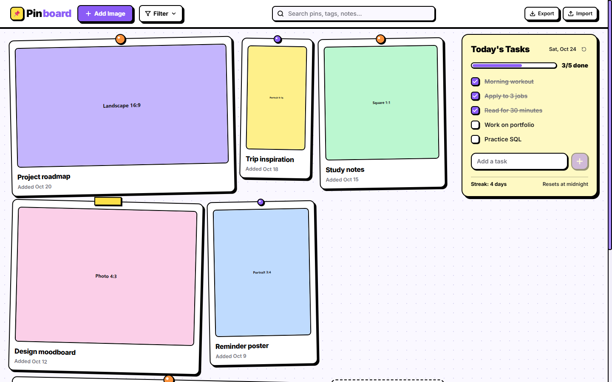
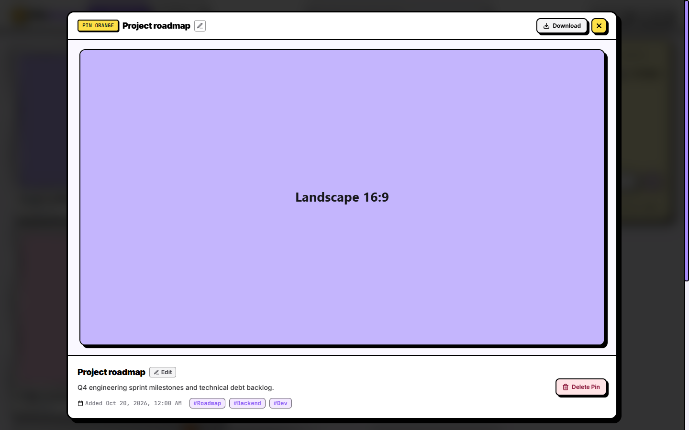
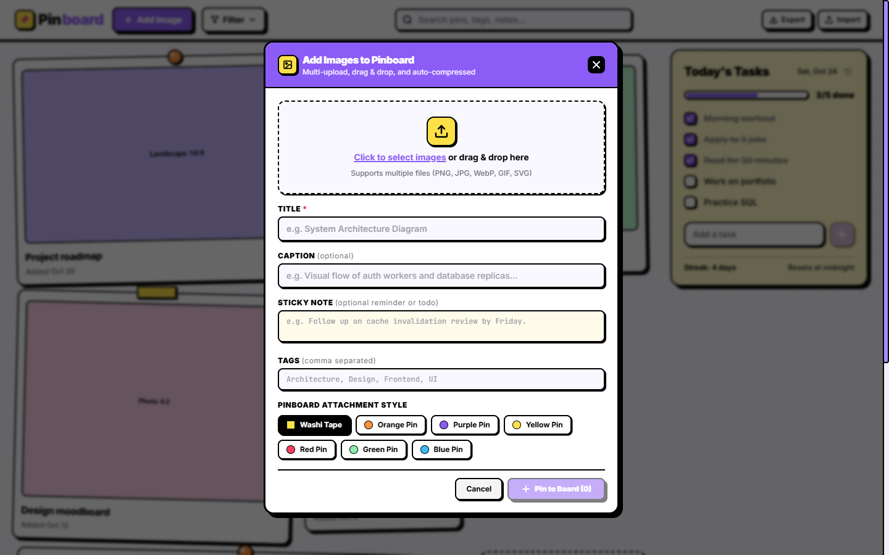

# 📌 Pinboard — Neo-Brutalist Visual Canvas & Daily Tasks

A responsive, single-page web app built with **React**, **Vite**, and **Tailwind CSS**, styled in a vibrant **Neo-Brutalist** aesthetic.



---

## 📸 Screenshots & Previews

| Full Visual Canvas & Fixed Tasks Tile | Fullscreen Lightbox & Edit |
| :---: | :---: |
|  |  |

<p align="center">
  <b>Multi-File Upload & Attachment Customizer</b><br/>
  
</p>

---

## 🎨 Visual Theme (Neo-Brutalist Look)

- **Soft Canvas Background**: Light off-white / lavender tint (`#faf8ff`) with a subtle pinboard dot-grid pattern.
- **Thick Solid Black Borders**: `2.5px` to `3px` solid black borders on all cards, buttons, inputs, and modals.
- **Hard Offset Shadows**: `4px 4px 0 #000` (and `5px 5px 0 #000` / `8px 8px 0 #000`) with **zero blur**.
- **Primary & Secondary Palette**:
  - Primary: Bold Purple (`#8b5cf6` / `#7c3aed`)
  - Accent: Warm Yellow/Amber (`#fde047` / `#facc15`)
  - Highlights: Pink (`#f472b6`), Mint (`#86efac`), Sky (`#93c5fd`)
- **Interactive Tactile Micro-Interactions**:
  - Buttons translate `2px` on hover (shadow shrinks to `2px 2px 0 #000`)
  - On active/click, buttons "press in" by `4px` (`shadow: none`)
- **Branded Header**: Styled as **Pin** (black) + **board** (purple `#8b5cf6`).
- **Notice Board Elements**:
  - Organic slight rotations (`-2°` to `+2°`)
  - Washi tape strips and colored pushpins with black outlines on top of cards.

---

## 🚀 Key Features

### 1. 📌 Notice Board & Image Management
- **Multi-Image Upload & Drag & Drop**:
  - Upload multiple images at once via the "+ Add Image" modal.
  - Drag and drop image files directly anywhere onto the screen or modal.
  - Automatic client-side canvas compression/resizing (max 1400px, 85% quality) to prevent browser storage bloat.
- **Card Actions & Lightbox**:
  - Click any card to open a full-size neo-brutalist **Lightbox Modal**.
  - Edit captions directly inline on the card or in the lightbox.
  - Delete with a two-step confirmation (`Delete? [✓] [✕]`) to prevent accidental deletion.
  - Reorder cards by dragging and dropping them on the board.
- **Persistent Storage**:
  - High-res images and pins are stored in browser **IndexedDB** for reliability.
  - Fast instant load with pre-populated sample architecture & design diagrams.

### 2. 📅 Today's Tasks Square (Top-Right Corner)
- **Top-Right Fixed Widget**:
  - ~300px wide neo-brutalist card with today's live date and daily completion streak (`🔥 3d`).
  - Snappy animated checkboxes with strike-through and progress counter (`3/5 done`) with a progress bar.
- **Daily Refresh Logic**:
  - Tasks persist in `localStorage`.
  - When a new day arrives (detected automatically on load and at midnight), all checkmarks reset to unchecked.
  - **Repeat Daily vs Today Only Toggle**:
    - `Repeat Daily`: Resets to unchecked each morning.
    - `Today Only`: Automatically cleaned up after the day ends.
  - **Simulate Tomorrow Button**: Includes a `"Simulate tomorrow"` button to test the daily rollover mechanism instantly without changing system time.
- **Mobile Responsive Drawer**:
  - Collapsible on desktop.
  - On mobile, transitions into a header badge button that slides out a dedicated drawer panel.

### 3. 🔐 Google Authentication & Multi-Tenant Data Isolation
- **1-Click Google Sign-In**:
  - Securely sign in using your Google account via Firebase Authentication.
  - Neo-brutalist user profile avatar and dropdown with active sync indicator.
- **Isolated Per-User Cloud Storage**:
  - Every user's pins, daily tasks, and streak history are strictly partitioned in Cloud Firestore under `/users/{userId}/...`.
  - No user can access or view another user's board or tasks.
- **Production-Grade Firestore Security Rules**:
  - Pre-configured `firestore.rules` enforcing `request.auth.uid == userId`, immutable timestamps/IDs, and schema bounds.
- **Guest Mode Fallback**:
  - Visitors without a login can still use the app offline with browser IndexedDB and LocalStorage.

### 4. 💾 Backup & Data Portability
- **JSON Export**: Download all your image pins, daily tasks, and streak history as a single `.json` file.
- **JSON Import**: Upload any backup file to restore your entire board state instantly.

---

## 🌐 Netlify Deployment & Firebase Setup

### 1. Firebase Project Setup (Free)
1. Go to the [Firebase Console](https://console.firebase.google.com/) and create a project.
2. In **Build > Authentication > Sign-in method**, enable **Google**.
3. Under **Authentication > Settings > Authorized domains**, add:
   - Your Netlify site domain (e.g. `your-pinboard.netlify.app`)
   - `localhost` (for local development)
4. In **Build > Firestore Database**, create a database and paste/deploy the provided [firestore.rules](file:///firestore.rules).
5. In **Project settings > General > Your apps**, register a Web App (`</>`) and copy your configuration keys.

### 2. Configure on Netlify
In your Netlify site dashboard, navigate to **Site configuration > Environment variables** and add:

```env
VITE_FIREBASE_API_KEY=AIzaSy...
VITE_FIREBASE_AUTH_DOMAIN=your-app.firebaseapp.com
VITE_FIREBASE_PROJECT_ID=your-app
VITE_FIREBASE_STORAGE_BUCKET=your-app.appspot.com
VITE_FIREBASE_MESSAGING_SENDER_ID=123456789012
VITE_FIREBASE_APP_ID=1:123456789012:web:...
```

*(You can also click **Sign in with Google** directly on your live site and paste your config into the built-in setup assistant for instant setup!)*

---

## 🛠️ Tech Stack

- **React 18** + **TypeScript**
- **Vite 6** (lightning-fast HMR and bundling)
- **Tailwind CSS 3** (neo-brutalist design tokens, borders, and hard offset shadows)
- **Firebase Auth** (Google federated sign-in)
- **Cloud Firestore** (multi-tenant real-time database with user-isolated security rules)
- **IndexedDB** (local guest offline image persistence)
- **Lucide React** (crisp neo-brutalist icons)

---

## 💻 Running Locally

```bash
# 1. Install dependencies
npm install

# 2. Start local development server
npm run dev

# 3. Build for production
npm run build
```

Once running, navigate to **`http://localhost:5173/`** in your browser.
